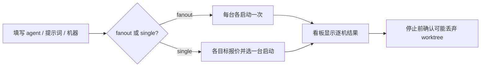

# herdr-web 功能目录

> 文件名沿用项目规则的 `Fetures.md` 拼写。此处只记录**当前代码可定位的能力与接口**，不把当前实现等同于目标。已确认的产品目标和验收以 [SPECS](docs/SPECS.md) 为准；风险与改进建议见 [审查报告](docs/review-2026-10-24.md)。阅读对象：操作者、刚接手项目的开发者。

## 1. 一句话理解

浏览器不能直接连接 herdr 的 Unix socket，所以单个 Go 程序同时提供 React 页面与 HTTP → herdr 桥接。可选择加入尾网机器集合，通过其他控制台分发任务、查看结果，并从发布源更新程序。它**不是无状态代理**：机器列表、任务事件、分发看板和最近的更新源均会写在本机。

本项目目前没有登录机制。能直连本服务的人可能读到运行用户有权读的文本文件，也可以向 pane 输入命令、控制任务以及调用安装/更新功能；只监听私有地址不等于认证。不要部署到公开网络或未经明确隔离的共享网络。

负责人已确认目标为“仅本人设备、仅人工更新、任务完成释放容量并保留结果”；**当前代码尚不完全符合**，以下接口按当前行为描述。

### 使用入口

| 场景 | 操作或参数 | 结果 |
| --- | --- | --- |
| 本机启动 | `make build`，再运行 `./herdr-web`；默认 Tailscale IPv4 `:5000` 与回环 `127.0.0.1:5001`。 | 服务页面和 API；无 daemon 时页面仍可用但显示不可达。 |
| 单机不加入尾网 | `./herdr-web -addr 127.0.0.1:18080 -local-addr ""` | 不启动机器发现/自动跟随循环。 |
| 指定 daemon | `-herdr-socket /absolute/path/to/herdr.sock` | 从指定 socket 转发 herdr RPC。 |
| 指定机器种子 | `-fleet-seeds http://host:5000` 或 `HERDR_WEB_FLEET_SEEDS` | 尝试与种子互换机器信息；种子不是权威认证。 |
| 并发上限 | `HERDR_WEB_MAX_JOBS=N`，不设置为 1，显式 0 表示不限制。 | 限制本机“运行中 + 启动中”槽位；任务 done/error 或人工停止即释放，结果与工作区保留。 |
| 关闭自动跟随 | `HERDR_WEB_FLEET_FOLLOW=off` | 停止尾网机器的自动跟随循环；手动更新入口仍存在。 |
| 访问主机名/上传目录 | `HERDR_WEB_ALLOWED_HOSTS`、`HERDR_WEB_UPLOAD_DIR` | 分别额外允许 HTTP Host 名、改附件存放目录；**不是认证开关**。 |

更多构建与部署命令见 [README](README.md)；不要把旧交接文档里的机器/版本观测当成当前状态。

## 2. 本机工作区、终端和文件

下面是常用 HTTP 接口速查。`{id}` 必须 URL 编码（例如 pane `w1:p1`）。成功的 JSON 形状写出关键字段，失败通常是非 2xx 的 `{"error":{"code","message","retryable"}}`；`GET /api/v1/herdr/status` 特例是 HTTP 200 + `status:"error"`。

| 请求 | 作用与主要参数 | 成功时返回 |
| --- | --- | --- |
| `GET /api/health` | 本服务存活；不探测 herdr。 | `{"status":"ok","service":"herdr-web"}` |
| `GET /api/v1/herdr/status` | daemon 和协议状态。 | `status`、`version`、`protocol`、`consoleVersion`，不可达时 `status:"error"`。 |
| `GET /api/v1/herdr/workspaces` | 列工作区。 | 工作区数组，含 `id/name/windows/agentStatus` 等。 |
| `POST /api/v1/herdr/workspaces` | JSON `label?`、`cwd?`、`command?:string[]`，建立工作区并可执行命令。 | `ok/workspaceId/paneId/label`；建成但命令失败时还含 `commandError`。 |
| `GET /api/v1/herdr/workspaces/{id}` | 获取工作区和其 pane。 | `workspace`、`panes`。 |
| `POST /api/v1/herdr/workspaces/{id}/rename` | JSON `{"label":"非空名称"}`。 | `ok/workspaceId`。 |
| `POST /api/v1/herdr/tabs` | JSON `workspaceId?`、`cwd?`、`label?`，创建 tab。 | `ok/tabId/paneId/workspaceId`。 |
| `GET /api/v1/herdr/panes` | 一次取所有 pane。 | `{"panes":[...]}`，含 `id/workspaceId/tabId/agentStatus`。 |
| `GET /api/v1/herdr/panes/{id}/read?lines=200&format=ansi` | 读取最近输出；`lines` 1～2000；格式为 `text/ansi`。 | `text/revision/truncated/agentStatus/paneId` 等。 |
| `GET /api/v1/herdr/panes/{id}/layout` | pane 所在 tab 的切分布局。 | `tabId/panes/splits/area/focusedPaneId`。 |
| `POST /api/v1/herdr/panes/{id}/input` | JSON `{"text":"文本"}`；向 pane 粘贴。 | `ok/paneId`。 |
| `POST /api/v1/herdr/panes/{id}/keys` | JSON `{"keys":["Enter"]}`；发送按键。 | `ok/paneId`。 |
| `POST /api/v1/herdr/panes/{id}/run` | JSON `{"command":["程序","参数"]}`；在 pane 运行命令。 | `ok/paneId`。当前工作区有旧 herdr 回退改动，尚未单独验收。 |
| `POST /api/v1/herdr/panes/{id}/split` / `close` / `resize` / `rename` | JSON：`direction`、可选 `ratio/amount`、或 `label`；关闭会终止 pane。 | `ok` 及相应 `paneId/tabId/direction`。 |
| `POST /api/v1/herdr/uploads` | `multipart/form-data` 字段 `file`，单请求上限约 32 MiB。 | `ok/path/name/bytes/kind`。附件在服务机器的临时目录。 |
| `GET /api/v1/herdr/file?path=` | 绝对路径，只读常规文件；文本返回前 256 KiB。 | `path/name/bytes/kind`，文本还含 `text/truncated`。 |
| `GET /api/v1/herdr/file/raw?path=` | 绝对路径，只输出受支持的光栅图片（非 SVG，最多 16 MiB）。 | 图片字节流，不是 JSON。 |
| `GET /api/v1/herdr/host/stat?path=` | 判断路径是否在本机；不代表能在别的 SSH 主机预览。 | `path/exists/isDir?`。 |
| `GET /api/v1/herdr/tmux` / `tmux/output?session=&lines=` | 兼容查询 tmux 会话与只读输出；不会 attach。 | 会话列表 / 输出文本。 |
| `GET /api/v1/herdr/host` | herdr 的安装、daemon、更新信息。 | `installed/binary/serverRunning/...`。 |
| `POST /api/v1/herdr/host/install` / `update` / `restart` | 在本机安装/升级/重启 herdr，可能影响运行中的 pane。 | 执行结果和步骤；应在 UI 确认。 |

## 3. 多机与任务

| 请求 | 作用与主要参数 | 成功时返回 |
| --- | --- | --- |
| `GET /api/v1/fleet` / `POST /api/v1/fleet/hello` | 查询机器；hello JSON 含 `id/addr/version/agents/maxTasks/running` 等。 | `self/peers/seeds/follow` / 更新后的机器列表。 |
| `GET /api/v1/herdr/agents` | 本机可以启动的 agent 类型。 | `{"kinds":[...]}`。 |
| `POST /api/v1/herdr/job/offer` | JSON `taskId/prompt/kind/cwd?/branch?/weight?`；评估能否接任务。 | `accept/reason/running/maxTasks` 与资源。 |
| `POST /api/v1/herdr/job` | JSON `prompt/kind` 必填，`taskId/cwd/branch/weight/label` 可选；启动本机工作区及 agent。taskId 与容量在同一把锁内预留。 | `ok/jobId/workspaceId/paneId/taskId?/branch?`，同 ID 顺序重试含 `reused`；同 ID 并发启动中的后续请求得到 409 `task_starting`，超容量得 429；agent 启动失败会自动关闭刚建的 workspace 并释放槽位。 |
| `GET /api/v1/herdr/job/task/{taskId}` / `GET /api/v1/herdr/job/{paneId}` | 查任务是否被认领（含 `starting`：正在创建）、查执行状态和输出。 | `running/starting/workspaceId/jobId` / `status/kind/output`。 |
| `GET /api/v1/herdr/job/{workspaceId}/diff` | 返回 worktree 当前分支、提交和未提交文件（只读）。 | `checkoutPath/branch/commits/changed`。 |
| `POST /api/v1/herdr/job/{workspaceId}/stop` | 关闭工作区，可能丢弃 worktree。 | `ok/workspaceId`。 |
| `GET /api/v1/herdr/jobs/ledger` | 看本机任务事件和上限。 | `maxTasks/running/events`。 |
| `POST /api/v1/fleet/job` | JSON `prompt/kind/targets?`、`cwd?/branch?/weight?`、`strategy:"fanout"|"single"`；默认 fanout。 | `ok/dispatch`；没有任何一台机器启动时 `ok:false`（fanout 与 single 一致），前端会显示每台拒绝原因并保留输入。分发 id 带随机后缀，同一秒多次发送不再撞号。 |
| `GET /api/v1/fleet/jobs` / `POST /api/v1/fleet/job/retry` / `POST /api/v1/fleet/job/stop` | 看分发看板（各机器并发查询，单台慢机器不再拖住全部）、按 ID 重试未启动任务、按 `host/workspaceId` 停任务——仅限本机记录过的分发，不认识的 404 `unknown_job`。 | `dispatches` / `ok/dispatch` / `ok/host/workspaceId`。 |

现状限制：没有全局队列或沙箱；agent 在服务账号下运行。`light/standard/heavy` 是资源提示，不会阻止 agent 自行编译。容量计数和幂等的并发/完成场景尚有问题，不能将返回的 `maxTasks` 视为强资源隔离。

## 4. 发布、数据位置及更新

| 请求 / 数据 | 用途及参数 | 返回 / 存放 |
| --- | --- | --- |
| `GET /api/v1/herdr-web/release` | 本机程序的版本、平台与摘要。 | `version/platform/sha256/source/executable`。 |
| `POST /api/v1/herdr-web/update` | JSON `{"from":"可选发布源"}`；获取新版本并替换文件。下载文件无法应答 `-version`（或版本不符）时拒绝安装。 | `ok/updated/steps/restart?`；当前可自选来源，**不能把校验和当身份认证**，下载后运行文件查版本这一步本身仍需可信发布改造兜底。 |
| `POST /api/v1/herdr-web/rollback` | 回滚到 `.previous`。 | `ok/rolled/restart`；需核对实际重启版本。 |
| `GET /release/version`、`GET /release/herdr-web-<os>-<arch>[.sha256]`、`GET /release/install.sh` | 将当前或已种入的发布文件给其他机器。 | 文本或二进制。 |
| `POST /release/{name}` | 种入版本/发布文件，服务端生成摘要。 | 发布文件及旁边的 `.sha256`；当前无访问者身份验证。 |
| `~/.local/share/herdr-web/jobs/ledger.jsonl` | 本机 append-only 任务事件。 | 重启时重放；目前无轮换。 |
| `~/.local/share/herdr-web/jobs/dispatch.json` | 本机最近 20 条分发记录（含任务提示词）。 | 重启时读取。 |
| `~/.local/share/herdr-web/fleet.json` / `update-source.json` | 已知机器列表 / 上次更新来源。 | 重启后继续使用。 |
| `$TMPDIR/herdr-web-uploads` 或 `HERDR_WEB_UPLOAD_DIR` | 附件落盘。 | 所有者和权限受检查；需自行清理过期文件。 |

上图描述**当前流程，不是安全承诺**：在可信发布改造前，建议不要将其推广至多人共享尾网。改造目标见 [SPEC-03](docs/SPECS.md#4-spec-03-发布更新与回滚)。

## 5. 这次梳理的反思

- 从单机 UI 到多机分发与发布，实际产品边界已变，旧版“完全无状态”的叙述过期；以后功能先更新 SPEC 的目标与失败规则，再写代码和交接记录。
- 复用机会：Fleet/Job/Self-update 都要处理远端 URL、超时和身份，可共用**明确准入与限时的远程客户端**；但发布者信任和普通机器身份不能混成一把令牌。文件上传、压缩与下载可共用有界流控，不能让二进制走文本缓冲路径。
- 已确认的取舍：仅本人受控设备、只人工更新、任务确认完成即释放容量并保留结果；这些仍需落地实现，默认分发策略尚待确认。不能把“已经跑通”写成“已安全验收”。
- 边界情况清单：daemon 离线、agent 完成但 workspace 保留、目标丢失回包、二进制多请求并发、旧 daemon 无 `pane.run`、移动端断网重连。已解决并有用例的：两次并发同 ID（最多一次 workspace.create）、容量 1 并发启动、agent 启动失败回收 workspace、慢机器不阻塞看板、fanout 全拒时 `ok:false`。仍需隔离验收：以上场景在真实 HTTP 环境的端到端复测。
