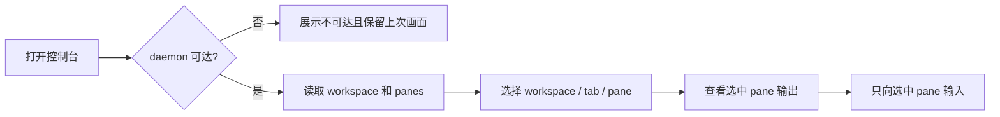
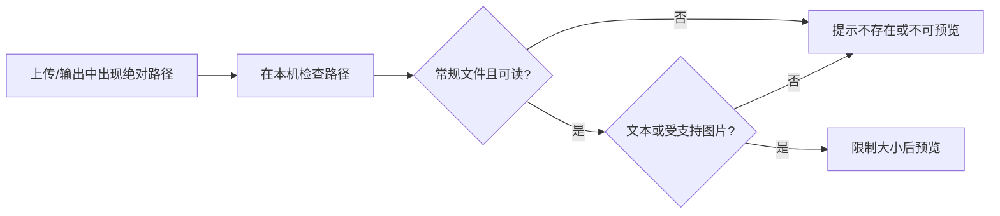
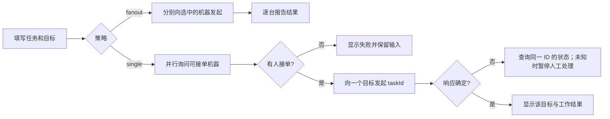
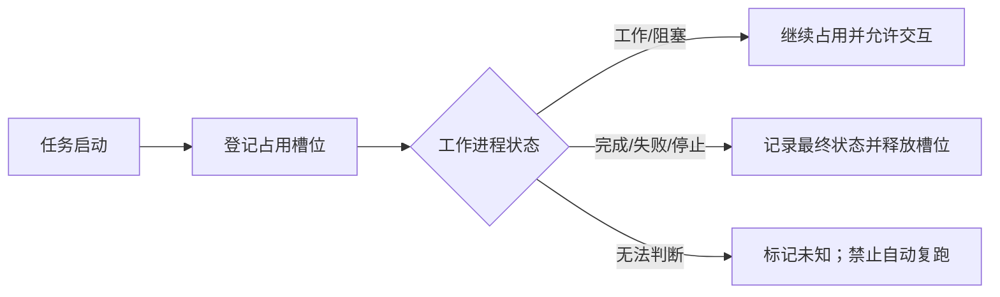
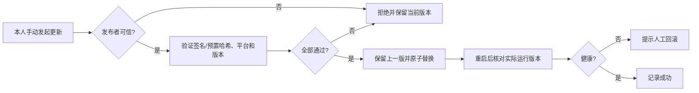

# herdr-web 产品规格（SPECS）

> 状态：**产品方向已确认，技术方案与验收仍为草案**。版本：0.2，整理日期：2026-10-24。
> 本文以当前工作区代码、[README](../README.md) 和 [HANDOFF](../HANDOFF.md) 为依据；“现状”不等于“已通过验收”。审查证据和风险见 [代码审查报告](review-2026-10-24.md)。具体接口索引见 [功能目录](../Fetures.md)。

## 0. 这是什么，不是什么

herdr-web 是由操作者运行的 Web 控制台：Go 进程把浏览器请求交给本机 herdr daemon 的 Unix socket，并可与其他控制台交换机器信息、分发任务和发布版本。herdr 管理 pane/workspace；每台执行机器保存自己的任务事件；发起机器保存自己的分发看板。

**已确认的产品方向**：只供本人受控设备使用；控制台仅人工更新；任务执行完释放容量、保留结果和工作区。允许使用自己的多台机器，不等于默认信任尾网内所有设备。认证/网络 ACL 的具体实施方式仍待设计，不能把“绑定私网地址”或“校验下载文件的 SHA-256”当作对访问者或发布者的认证。

**不在本轮范围**：多租户、全局一致的任务队列、跨机器自动合并代码、任务沙箱、任意公网暴露。若要引入其中任何一项，先新增规格和验收标准，不顺手添加。

**状态标记**：`现有` = 能在代码中定位；`目标` = 建议达到但尚未实现/验证；`待定` = 需要产品负责人决策。

## 1. 不变量与边界

| ID | 约束 | 当前状态与验收方向 |
| --- | --- | --- |
| INV-01 | herdr 是 pane/workspace 的事实来源；daemon 重启不是“所有数据被删除”。 | 现有：轮询失败时界面保留上次数据并显示离线；不得以空列表覆盖。 |
| INV-02 | 任务属于执行机器；分发者保存目标和展示结果，不自行持有远端进程。 | 现有：本机 `ledger.jsonl`、分发端 `dispatch.json`；目标：重启与异常结束后状态仍可信。 |
| INV-03 | 任务不应因网络超时被自动复制到第二台机器。 | 现有：`single` 在结果未知时尝试查询目标，但不能保证不会重复；目标：单目标同一 taskId 并发只创建一次，跨目标不明结果时不自动转移。 |
| INV-04 | 高权限操作仅允许本人受控设备发起；发布者必须可信。 | **目标已确认，实现未达成**：目前服务无用户认证、`/release/*` 可上传、更新可从远端取可执行文件。 |
| INV-05 | 不对已经运行的 herdr daemon 做未确认的停止/升级；停止任务可能丢弃 worktree。 | 现有 UI 为停止任务提供确认；自动更新 herdr 与控制台自身更新的权限须分开。 |
| INV-06 | 本机仅监听回环、RFC1918、Tailscale 或 IPv6 ULA；未知 `/api` 路由返回 404。 | 现有；**地址私有不代表请求者可信**。 |

## 2. SPEC-01 本机控制台

**目标**：在没有 herdr、herdr 暂时断开、以及 herdr 正常工作时都提供明确反馈；操作者可以选 workspace → tab/pane → 查看输出 → 输入、切分、改名或关闭。

| 编号 | 规则与验收标准 | 状态 / 实现 |
| --- | --- | --- |
| L-01 | 启动时即使 daemon 不可达，UI 仍可加载；状态接口返回 `status:"error"`，页面展示不可达而不是清空既有 pane。 | 现有：`server/bridge.go`、`web/src/App.tsx`；待以 HTTP + 浏览器场景验收。 |
| L-02 | workspace 列表按 daemon 返回顺序；可创建、重命名；tab 可创建；输入只送到明确选中的 pane。 | 现有：`server/bridge.go`、`web/src/App.tsx`、`web/src/components/PromptBar.tsx`。 |
| L-03 | pane 的历史输出含 `text/revision/truncated/agentStatus`；普通文本换行，全屏 TUI 保持终端布局；异常不被误写成空输出。 | 现有：`server/bridge.go`、`web/src/components/Scope.tsx`。 |
| L-04 | 文件上传限制 32 MiB，文件预览只读常规文件；文本最多 256 KiB，原始图片最多 16 MiB，拒绝 SVG 当图片执行。 | 现有：`server/uploads.go`、`server/file.go`。访问者权限待定，见 SEC-01。 |
| L-05 | 工作区创建后运行命令若失败，应显示“工作区已创建、命令失败”，不能报整个创建失败。 | 现有：`server/bridge.go`；兼容旧 herdr 的命令回退处于当前未提交工作中。 |

## 3. SPEC-02 机器发现与任务分发

**目标**：小规模机器互相发现，可人工选择 `fanout`（每台各跑一次）或 `single`（只在一台执行），失败时状态可解释、不会偷偷重复执行。

| 编号 | 规则与验收标准 | 状态 / 实现 |
| --- | --- | --- |
| F-01 | 仅 Tailscale 监听器启用发现和跟随循环；仅回环监听器为单机模式。机器广播自身 agent、资源和并发上限。 | 现有：`server/run.go`、`server/fleet.go`。广播值现在没有身份校验。 |
| F-02 | `fanout` 向每台选中机器分别发起一个任务；返回各目标的成功/失败，部分失败不得显示为全部成功。 | 现有后端；前端需核对 `ok` 字段，见审查报告 LOG-03。 |
| F-03 | `single` 并行 offer，按容量/任务重量选一台；返回 `ok:false` 且无任务启动时，UI 保留提示和原输入，允许人工 retry。 | 后端现有；前端不满足失败提示要求。 |
| F-04 | 任务唯一键为 `taskId`；同一执行机器上同 ID 的并发请求只能创建一个 workspace，容量上限不能被并发请求冲破；跨目标结果不明时不得自动重复运行。 | **目标，未达成并发原子性**，见 LOG-01。不同发起机器对同一 ID 的全局恰好一次保证需要额外协调，当前设计不承诺。 |
| F-05 | “运行中”应表示任务真实占用执行槽位；任务确认完成或失败后释放容量，保留工作区和结果；手动停止、进程消失与短暂闲置要区分。不能仅依靠关闭 workspace 才释放槽位。 | **方向已确认，实现未达成**，见 LOG-02。 |
| F-06 | 远程目标失联后的结果为 `unknown/lost`，人工确认前不自动转移；停止前提示可能丢弃 worktree。 | 现有部分流程，待故障注入 HTTP 验收。 |

## 4. SPEC-03 发布、更新与回滚

**现状**：可从 GitHub、指定来源或其他控制台取得版本、SHA-256 和可执行文件；Tailscale 成员默认定期跟随较新版本；覆盖前保留 `.previous`；可以回滚。SHA-256 当前来自同一分发端，证明传输一致性，不证明发布者身份；下载后执行 `-version` 不能作为安全校验。**已确认目标是只允许操作者手动启动更新**，但本轮未改默认配置或代码。

| 编号 | 安全目标 / 验收标准 | 状态 |
| --- | --- | --- |
| U-01 | 仅信任明确允许的发布主体；版本元数据与文件须由独立受信来源验证（例如签名或预置哈希）；失败保持旧版本。 | 产品方向已确认，具体发布验证方案待设计。 |
| U-02 | 验证可执行文件的来源与版本时，不运行未经认证的文件；即使校验失败，也绝不能执行文件或重启服务。 | 目标；当前违反，见 SEC-01。 |
| U-03 | 非本人受控设备不能上传发布文件或触发手动更新；任何机器都不得自动跟随。 | 目标；当前违反，见 SEC-02。 |
| U-04 | 原子替换、保留旧版本、回滚，以及更新后服务真实运行的验证，都有成功/失败可观察结果。 | 前半现有；自动跟随重启时仍需完整验收。 |
| U-05 | 默认关闭自动跟随；仅由本人明确点击/调用手动更新。手动更新仍须验证来源、平台、版本及失败回滚。 | **方向已确认、未实现**；当前尾网实例默认可能自动跟随，只有 `HERDR_WEB_FLEET_FOLLOW=off` 才关闭循环。 |

## 5. SPEC-04 权限与网络安全

**已确认威胁模型边界**：仅本人受控设备能够执行高权限操作；不能假设尾网内其他设备都可信。共享机器、同一账号的其他设备或未经隔离的反向代理不自动成为操作者。当前 `Host/Origin/Content-Type` 防护面向浏览器跨站请求，**不是 API 鉴权**。

| 编号 | 建议验收标准 | 状态 |
| --- | --- | --- |
| SEC-01 | 只允许本人受控设备访问读取本机文件、向 pane 发送输入、关闭任务、herdr 安装/重启、发布/更新接口；默认拒绝其他设备。 | 使用范围已确认；机器身份、网络 ACL 或认证方式待设计。 |
| SEC-02 | 分发目标和下载源必须是事先允许的控制台/发布源，禁止任意 URL/跳转跨越该范围；错误信息不泄露凭据。 | 目标，见 SEC-03。 |
| SEC-03 | 即使在私网，也要限制上传/下载体积、HTTP 读取时间与并发；禁止把自动更新接到未经验证的 peer 消息。 | 部分现有，未满足全部。 |
| SEC-04 | 原有“仅私网绑定、拒绝跨站写、路径/文件类型限制”继续保留，且不把它们当作登录方案。 | 现有基本边界。 |

## 6. SPEC-05 性能、可观测性与移动端

| 编号 | 建议验收标准 | 状态 |
| --- | --- | --- |
| P-01 | `/release/*`、原始图片等二进制响应不因浏览器支持 gzip 就整文件缓存在 Go 内存；并发下载时内存应受控。 | 目标，见 PERF-01。 |
| P-02 | 任务看板查询不应对 20 条历史记录、多个目标逐个等待超时；应有并发上限、结果缓存或按需加载，后台/隐藏时避免无效请求。 | 目标，见 PERF-02。 |
| P-03 | 控制台与 pane 轮询按可见性/输出变化退避；以慢链路上的首次内容、看板响应时间、内存峰值和 HTTP 请求数作为回归指标。 | 前端已部分实施；需要建立本版本基线再定量化门槛。 |
| P-04 | 手机可完成 workspace 选择、输入、切换输出布局、查看任务、确认停止；关键按钮可触达。 | 已有响应式 UI；真实 iOS Safari 尚待验证。 |

历史交接文档记录过 **800 ms RTT 场景**首次内容优化前后数据，属于旧版本测量，不当作今天的通过证据或新版本 SLA。

## 7. 验收方式和变更纪律

1. 新想法先登记 `SPEC-ID`：**用户收益 → 非目标 → 最小方案 → 边界/失败方式 → HTTP 验收**。只做 UI 整理不新增后端能力时，可在原 SPEC 下加条目。
2. 更改安全边界、自动更新、任务语义或默认策略，先写待定决策和取舍，由负责人确认后才标记 `已批准`；不要用“代码已存在”代替授权。
3. 每条需求写明请求方式、状态码、必要响应字段和异常行为；实现后标记“代码已实现 / HTTP 已验证 / 浏览器已验证”，不能只写“完成”。
4. 任何功能性 HTTP 测试仅在专用测试环境与 `.env.test` 存在时进行；本仓库目前没有 `.env.test`，本轮没有执行功能性 HTTP 验收，也没有访问线上机器。
5. 每次发布前检查安全门禁、并发/失联、回滚、慢链路数据及规格到代码的映射；出现新风险更新 [审查报告](review-2026-10-24.md) 的状态。

## 8. 决策记录与剩余问题

| 决策 | 确认结果与尚需解决的问题 | 对应规格 |
| --- | --- | --- |
| DEC-01 谁可以用？ | **已确认：仅本人受控设备**。仍需规定如何准入设备，不能把“尾网可达”当授权。 | SEC-01、INV-04 |
| DEC-02 是否自动跟随更新？ | **已确认：仅人工更新，不自动跟随**。需要更改现有默认行为；人工更新也必须验证发布者身份。 | U-01～U-05 |
| DEC-03 任务完成与工作区关系？ | **已确认：执行完成即释放容量，保留结果/工作区**。需要区分 agent 暂时空闲和任务终态；新的交互如何重新计入容量须在实现时定义。 | F-04、F-05 |
| DEC-04 默认分发策略？ | **待确认**：当前是 `fanout`；每台机器可能执行重复费用/副作用。`single` 节约资源，但调度需更强幂等。 | F-02、F-03 |

**下一步顺序**：落实 DEC-01/02 的访问隔离与默认仅人工更新 → 修复 SEC-01/02 → 落实 DEC-03 的任务终态、并发/前端错误反馈 → 明确 DEC-04 → 优化大文件及看板查询 → 做 HTTP 和慢链路验收。**这份记录不会自动调整现有机器：当前仍可能自动跟随**，需单独评估部署配置。
